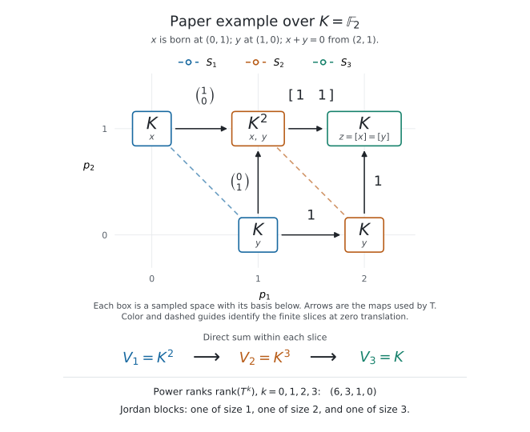

# JordanType

A standalone C++ library for exact Jordan types and translated Jordan filtered ranks of finitely presented persistence modules over **F₂**.

The mathematical construction is due to Calin Chindris, Min Hyeok Kang, and Daniel Kline in [The Jordan type of a multiparameter persistence module](https://arxiv.org/abs/2510.22116). The input is a graded presentation, an ordered finite slice pattern, and the requested translations.

[Build](#build-and-run-the-checks) · [CLI usage](#using-the-cli) · [Methods](#methods) · [C++ interface](#c-interface) · [Input files](#input-files) · [Benchmarks](#benchmarks) · [Dependencies](#dependencies) · [Installation](#installation)

## Build and run the checks

Build with a compiler that supports C++20, CMake 3.20 or newer, and Boost headers. From the project directory:

```sh
cmake -S . -B /tmp/jordan-type-build -DCMAKE_BUILD_TYPE=Release
cmake --build /tmp/jordan-type-build -j 2
ctest --test-dir /tmp/jordan-type-build --output-on-failure
```

`CMakeLists.txt` defines the library, CLI, and test targets built by these commands. The first configuration downloads the dependency archives described [below](#dependencies). Build output goes into `/tmp/jordan-type-build`; another directory outside the source folder can be used instead. Repeat the commands to rebuild after clearing that directory.

For a library build, set `JORDAN_BUILD_TESTS=OFF` and `JORDAN_BUILD_CLI=OFF`. These are the defaults when another CMake project includes this one. The [benchmark targets](#benchmarks) are built separately.

## Using the CLI

The build above creates `/tmp/jordan-type-build/jordan_type`. Its commands take an [SCC2020 presentation](#scc2020-presentation) followed by a [slice pattern](#slice-pattern).

### Jordan type

Compute the Jordan type for your input files:

```sh
/tmp/jordan-type-build/jordan_type type module.scc pattern.slices
```

For the supplied paper example, run this from the project directory:

```sh
/tmp/jordan-type-build/jordan_type type examples/paper.scc examples/paper.slices
```

```text
power ranks: 6 3 1 0
Jordan block counts: 1 1 1
```

- `power ranks` gives the ranks of successive powers of the slice operator `T`, beginning with the identity `T^0`. Here the total sampled space has dimension 6, and the next three ranks are 3, 1 and 0.
- `Jordan block counts` gives the number of blocks of each size, starting at size 1. This example has one block of size 1, one of size 2 and one of size 3.

By default, `type` uses the slice coordinates as supplied and selects the algorithm automatically. These options change the translation or method:

| Option | Effect |
| --- | --- |
| `--shift "1 2"` | Add `(1,2)` to every point in the pattern; supply one coordinate per parameter |
| `--method METHOD` | Choose `automatic`, `rank-blocks`, or `streaming` |

### Filtered ranks

Use `ranks` with source and target translations satisfying `source <= target` coordinatewise:

```sh
/tmp/jordan-type-build/jordan_type ranks examples/paper.scc examples/paper.slices \
  --source "0 0" --target "0 0"
```

```text
filtered ranks: 6 3 1
```

These entries cover powers `0,...,n-1`, where `n` is the number of slices. Add `--power 1` to request a single power; this example then prints `filtered rank[1]: 3`.

### Input and output

Quote each coordinate vector as one argument, with spaces between coordinates. Use `-` for one of the input paths to read it from standard input:

```sh
/tmp/jordan-type-build/jordan_type type - examples/paper.slices < examples/paper.scc
```

`--help` lists all options. A successful query writes its result to stdout and exits with status 0. A failed query writes a diagnostic to stderr and exits with status 1.

The paper inputs, [paper.scc](examples/paper.scc) and [paper.slices](examples/paper.slices), are illustrated below at zero translation. Colors group the finite slices; arrows show the maps used by `T` between consecutive slices. The CLI tests check this example's exact output with both algorithms and automatic selection.



## Methods

Let `M` be the presented persistence module, and let `S_1,...,S_n` be the ordered, pairwise disjoint finite slices, with `n >= 2`. A slice may be empty or contain comparable points. For translation `a`, the space of slice `l` is

    V_l(a) = direct_sum_{s in S_l} M_(a+s).

The adjacent map `A_l(a): V_l(a) -> V_(l+1)(a)` uses the module map from `a+s` to `a+t` when `s < t`, and zero otherwise. The operator `T_a` on the direct sum of all slice spaces has those adjacent maps in its subdiagonal blocks and zeros elsewhere. Consequently `T_a^n = 0`.

For comparable points, the block uses the full structure map, including compositions along the poset. With two slices, `rank(T_a)` is their multirank.

For `a <= b`, let `D_(b,a)` be the block diagonal map transporting each sampled space from `a+s` to `b+s`. We compute the filtered ranks

    rho_k(a,b) = rank(D_(b,a) T_a^k).

At `a = b` these are the power ranks of `T_a` and determine its Jordan block counts. Each query evaluates these ranks over F₂ at the supplied translations.

Both computational methods use the quotients at the sampled points. The method using rank blocks computes ranks from scalar path coefficients; streaming computes interval lengths in the chain of slice spaces.

### Input spaces and maps

At a parameter `p`, let `G_p` be the vector space on active generators and `R_p` the span of active relation columns. The module space is `M_p = G_p / R_p`. A generator and a relation are active when their grade is coordinatewise at most `p`.

For `p <= q`, inclusion of the active generators induces `M_p -> M_q`. Grade compatibility of the input relations ensures that every source relation maps into the target relation space. The implementation validates that compatibility before constructing any query cache.

### Path coefficients

For slices `S_l` and `S_(l+1)`, define a scalar matrix `B_l` with entry one at `(t,s)` exactly when the point `s` is strictly below `t`. The module operator uses the corresponding structure map in that block.

For power `k`, define

    C_(l,k) = B_(l+k-1) ... B_l.

Each entry is the number of paths through the consecutive slices, reduced modulo two. Every such path from `s` to `t` composes to the same structure map `M_(a+t,a+s)` by functoriality. Consequently, the `(t,s)` block of `T_a^k` is

    C_(l,k)[t,s] * M_(a+t,a+s).

For comparable shifts `a <= b`, composing with transport changes the endpoint map to `M_(b+t,a+s)`, preserving its scalar coefficient. The path matrix is the same for every translation and every input presentation.

For each source point, a path matrix stores a sorted list of target indices with odd path multiplicity. Sparse column XOR composes these parities; for example, the two paths through a diamond cancel in F₂. Pattern construction prepares the adjacent comparisons. Higher powers are prepared when requested and retained for reuse. A mutex protects construction of new path matrices, and completed matrices are immutable, allowing independent engines to share a pattern.

### Quotient coordinates

For each distinct set of active generators and relations, the arithmetic backend performs a triangular column reduction of the active relations. Each nonzero reduced column has a distinct largest pivot row. The active generators whose indices are nonpivot rows give a basis of the quotient.

To map a quotient basis generator `g` to a later grade, reduce the unit vector `e_g` by the target relation basis. At each step, eliminate the largest remaining row using its relation column if it is a pivot. Otherwise, retain it as a quotient coordinate and continue with the lower rows.

Each step removes the largest remaining row, so the process terminates. The retained vector represents the same quotient class using nonpivot rows, giving unique quotient coordinates. The engine caches this normal form for each requested generator in a reduced target space.

Grades with identical active generator and relation index sets share that reduced space and its normal forms. Membership sets use 64 bits per word; a hash locates candidate matches, and equality of the sets determines reuse. A lookup by exact grade reuses the classification of repeated coordinates. Each sampled point contributes its own summand and keeps its slice comparisons, including when it shares a reduction with another point.

### Block ranks and Jordan counts

Fix a start slice `l` and a power `k`. For each quotient basis generator at a source point, concatenate its target normal forms at points selected by `C_(l,k)`. Different target points occupy disjoint row ranges. The resulting sparse matrix represents exactly the corresponding block of `D_(b,a) T_a^k`.

Different start slices have different target slices for a fixed power. The blocks therefore form a direct sum, giving

    rho_k(a,b) = sum_l rank(block_(l,k)(a,b)).

At equal translations these are the ranks of powers. Set `r_0` to the total sampled quotient dimension and `r_n = r_(n+1) = 0`. The multiplicity of a block of size `i` is

    a_i = (r_(i-1) - r_i) - (r_i - r_(i+1)).

The implementation uses differences to avoid unsigned overflow from forming `2*r_i`. It checks rank monotonicity and the nonnegativity of these second differences. Once a power has rank zero, subsequent powers also have rank zero.

### Streaming interval lengths

[Proposition 5 of the paper](https://arxiv.org/html/2510.22116v1) identifies Jordan block sizes with interval lengths in the equioriented sequence of slice spaces. The streaming algorithm obtains these lengths by processing each adjacent arrow once.

Maintain a basis of the current slice space, with each basis vector labelled by its birth slice. Keep the vectors in nondecreasing birth order. For an adjacent arrow `A_l`:

1. Apply `A_l` to each current basis vector.
2. Append the standard basis of the target space after those image columns.
3. Reduce this combined matrix from left to right, preserving column positions and zero columns.
4. A propagated column that reduces to zero ends an interval at the transition, with its recorded birth. A nonzero old column continues that interval. A nonzero appended standard vector begins a new interval in the target slice.
5. Carry the surviving reduced columns and their birth labels to the next step. At the final slice, end every surviving interval.

Prefixes of the current basis span the images of the earlier slices. Column reduction adds an older or equally old vector to a later vector, preserving that filtration. If an older and a younger vector have equal images, the older interval continues and the younger interval ends.

Appending the target identity extends the propagated image basis to a full basis. The surviving complement consists exactly of the new births. This establishes the same invariant at the next slice and proves the algorithm by induction.

An interval born at index `b` and ending before index `e` contributes one block of size `e-b`. After counting those lengths, recover power ranks from

    r_k = sum_i max(i-k, 0) * a_i.

The implementation computes this recurrence using successive rank drops in a single pass through the block counts.

### Default method selection

The default uses rank blocks for at most five slices. For longer patterns it checks whether every scalar path block of length two vanishes over F₂. When they do, `T^2 = 0` for every presentation and translation, and the default uses rank blocks to calculate `rank(T)`. Otherwise it selects streaming.

Either method can also be selected explicitly. The cutoff at five slices comes from the [method comparison measurements](benchmarks/results/2026-11-09-methods.csv).

### Independent verification

The tests load module inputs from SCC2020 files and sampling patterns from `.slices` files. Named cases in [tests/cases](tests/cases) include `fork_shared_kernel.scc`, `death_transport.scc`, `older_birth_survives.scc`, and `membership_word_boundary.scc`. The paper example is shared directly from `examples/paper.scc` and `examples/paper.slices`.

The cases are grouped by property: `oracle/` contains 240 presentations and patterns; `direct_sums/` contains 30 triples (two modules and their sum), and `basis_changes/` contains 30 pairs; `uneven_layers/` contains 24 presentations and patterns; and `readers/` contains valid formatting cases and named malformed inputs. The files in `basis_changes/` record the row operations relating each pair of presentations. `oracle/queries.txt` supplies the case name followed by its source and target coordinates; the lists for pairs and triples supply the related case names.

C++ test code contains expected results and checks properties such as additivity under direct sums and cache reuse. It also modifies or truncates loaded inputs to exercise error handling. The [file helpers](tests/cases.hpp) locate the data using the source path supplied by CMake, so the tests can run from any working directory. CLI tests use the same input files.

The test oracle uses ambient generator spaces, constructs the full nilpotent matrix and transport matrix, and explicitly multiplies powers. It builds the target relation matrix and evaluates

    rank([D T^k | R_target]) - rank(R_target).

This rank formula applies when the lifted map sends source relations into target relations. Grading compatibility and naturality ensure this for `D T^k`.

The oracle has its own implementation of dense Gaussian elimination. Both Jordan methods are compared with its results. Tests also cover the paper's examples, direct sums, homogeneous generator basis changes, repeated relation grades, empty spaces and slices, invalid coordinates, birth ordering, long known intervals, uneven layers, and concurrent preparation through independent engines sharing a pattern.

### Computational cost

Let `g` and `r` be the presentation's generator and relation counts. Evaluating a new grade scans these `g+r` grades to identify the active generators and relations. A new combination of active indices requires a relation reduction. A repeated combination reuses its reduction and cached normal forms. Repeated coordinates also reuse the classification. Rank computation depends on quotient dimensions and on how dense the columns become during reduction. The cost of cache lookup and storage when active data rarely repeat is recorded in the [cache study measurements](benchmarks/results/2026-11-16-active-cache.csv).

Pattern construction compares consecutive slices. Computing all powers by rank blocks can require path matrices for a quadratic number of slice pairs. Streaming uses adjacent maps, with an additional check of paths of length two when automatic selection chooses the method.

Streaming performs one basis propagation and reduction per adjacent arrow. Its cost depends on how dense the basis and image columns become, and on the work needed to extend each image to a basis of the target space. Short patterns and strong path cancellation can favor rank blocks.

### Retained state and ownership

Each `Engine` owns its presentation, a lookup by exact grade, and one relation reduction per distinct set of active indices. Different grades can share a reduction and its cached generator normal forms. `cached_grades` counts coordinates; `cached_reductions` counts distinct prepared spaces, including zero spaces. Memory use grows with the stored grades, membership sets, reductions and normal forms. `clear_cache()` or engine destruction releases this state. Each call computes its result using these cached preparations.

Each engine computes on one thread. Give each concurrent worker its own `Engine`. Copies of a `SlicePattern` share immutable points and synchronized geometry caches. These caches belong to the pattern and live until its last copy is destroyed; clearing an engine's cache preserves them.

## C++ interface

All public types are in `jordan::f2`. Include `<jordan/jordan.hpp>` for computation, and `<jordan/io.hpp>` for file or stream input.

A `Presentation` owns the following data:

| Member | Meaning |
| --- | --- |
| `num_parameters` | Positive number of parameter coordinates |
| `generator_grades` | One grade per generator |
| `relation_grades` | One grade per relation |
| `relations` | Sparse relation columns containing generator indices numbered from zero, with coefficient one |

Each grade has `num_parameters` coordinates. Relation indices are checked against the generator array before duplicates cancel modulo two. Every remaining entry refers to a generator born coordinatewise at or before the relation. Presentations may contain redundant relations, repeated grades, and zero columns. Generator and relation counts fit in `Index`, a signed integer with 32 bits.

Grades are points in `R^d` with the coordinatewise order, for any positive finite parameter count `d`. The presentation and slice pattern are finite, and sampled points can be placed irregularly. The presented module may have unbounded support.

Coordinates are finite `double` values. Activation and inclusion use coordinatewise `<=` on the stored values, including equality. Translation adds the coordinates using `double` arithmetic. The linear algebra is exact over F₂.

Entry `i-1` of `block_multiplicities` counts blocks of size `i`.

| Operation | Output or effect |
| --- | --- |
| `jordan_type(pattern, shift, method)` | Power ranks `0,...,n`, including the terminal zero, and block counts for sizes `1,...,n` |
| `filtered_rank(pattern, power, source, target)` | One filtered rank; powers at least `n` return zero |
| `filtered_ranks(pattern, source, target)` | Filtered ranks for powers `0,...,n-1` |
| `clear_cache()` | Release cached spaces and reset reuse counters |
| `cache_statistics()` | Retained grades and reductions, hits in the lookup by grade, and computed generator normal forms |

The optional `JordanMethod` is `automatic`, `rank_blocks`, or `streaming`; see [method selection](#default-method-selection). Filtered ranks use rank blocks. A query supplies one coordinate per parameter, and filtered queries use `source <= target`. Invalid inputs and incomparable shifts raise `std::invalid_argument`; counts or matrix sizes exceeding the index range raise `std::length_error`; nonfinite translated coordinates raise `std::overflow_error`.

## Input files

### SCC2020 presentation

Supply one presentation in SCC2020 format. The first nonblank, uncommented line is `scc2020`, which identifies the format regardless of the filename extension. The supplied [paper.scc](examples/paper.scc) is:

```text
scc2020
2
1 2 0
2 1 ; 0 1
0 1 ;
1 0 ;
```

The records give the header, parameter count, and relation and generator counts with an optional terminal zero. Next come one row per relation, then one row per generator. A relation row has its grade, a semicolon, and the generator indices occurring in its column. A generator row consists of its grade followed by a semicolon. Generator and relation order are retained.

This describes a sparse graded matrix whose rows have generator grades and whose columns have relation grades. Those grades determine where the active generators and relations change.

Here two generators appear at `(0,1)` and `(1,0)`, and their sum becomes a relation at `(2,1)`.

### Slice pattern

A slice file has header `jordan-slices-v1`, followed by the parameter and slice counts. Each slice then starts with its point count, followed by one coordinate vector per line. The data in [paper.slices](examples/paper.slices) is:

```text
jordan-slices-v1
2 3
2
0 1
1 0
2
1 1
2 0
1
2 1
```

The three slices contain two, two, and one points. A pattern has at least two slices, with count zero representing an empty slice. Points are distinct across the entire pattern. The reader retains the supplied order, and the pattern uses the same parameter count as the presentation. Translations are supplied when querying.

### Text rules and reader behavior

- Spaces, tabs, CRLF line endings, blank lines, and `#` comments are accepted. A comment runs to the end of its line. The final newline is optional.
- Coordinates use decimal or scientific notation with a dot as decimal separator, independently of locale. Parsing produces finite `double` values and reports conversion errors, including overflow and underflow reported by the converter.
- Counts and indices are unsigned decimal integers up to `2^31 - 1`. Generator indices start at zero; each index in a relation column contributes coefficient one in F₂.
- Each presentation row contains one grade and one semicolon, with optional whitespace around the semicolon. Presentations may contain zero counts and zero relation columns, as described in the [C++ interface](#c-interface).

`read_presentation_file(path)` and `read_slice_pattern_file(path)` open and close their streams and return objects that own the parsed data. From C++:

```cpp
#include <jordan/io.hpp>

jordan::f2::Engine engine(jordan::f2::read_presentation_file("examples/paper.scc"));
auto pattern = jordan::f2::read_slice_pattern_file("examples/paper.slices");
auto result = engine.jordan_type(pattern, {0, 0}); // example with two parameters
```

For streams supplied by the caller, use `read_presentation(stream)` or `read_slice_pattern(stream)`. They read sequentially through EOF. The caller retains ownership, and the stream stays at the position reached during parsing, including when an error occurs. Malformed data raises `std::invalid_argument`, sizes exceeding the index range raise `std::length_error`, and failures to open or read a file or stream raise `std::ios_base::failure`. Syntax errors include a line number; file readers also include the path.

The reader stores the parsed data while processing one line at a time. File input and presentations supplied directly to `Engine` share validation and F₂ normalization. Quotient reductions are prepared when a query requests them.

## Benchmarks

Benchmarks use SCC2020 and slice files for fixed datasets, and named recipes in [workloads.hpp](benchmarks/workloads.hpp) for generated families. Each recipe builds one presentation and pattern and computes translations from query indices. The drivers construct and finish one workload at a time, checking or writing each answer as it is produced.

The benchmark suite includes nine saved presentations from geometric and observational data, generated families of varying size and density, changes of basis, and studies of slice placement and resolution. Mathematical controls exercise cancellation and distinguish modules with the same classical rank invariant. The [dataset sources](benchmarks/data/sources.json) identify each saved presentation.

Build and run the benchmarks:

```sh
cmake --build /tmp/jordan-type-build --target jordan_benchmark jordan_method_benchmark -j 2
/tmp/jordan-type-build/jordan_benchmark fractional_grid --cache reuse
/tmp/jordan-type-build/jordan_method_benchmark mixed_chain --cache reset
```

`jordan_benchmark` measures the first and repeated query batches for rank blocks, streaming and filtered ranks. `jordan_method_benchmark` compares rank blocks, streaming and automatic selection with five timed repetitions in rotating order. Each method has its own engine so the cache states are comparable. Complete answers are checked outside the timed passes; timed batches also check their result checksums. Verification and optional export process one query at a time.

Both programs accept the same settings:

| Setting | Meaning |
| --- | --- |
| Workload name, or `all` | Select one named case, or run the program's cases sequentially; names include saved datasets and generated recipes |
| `--list` | Print the case catalogue and input paths |
| `file --presentation P.scc --slices S.slices` | Load one fixed presentation and sampling pattern, in any supported parameter count |
| `--queries N` | Evaluate N queries; named cases repeat their finite schedule as needed |
| `--step "x y ..."` | With `file` and `--queries`, generate translations `0, step, 2*step, ...`; file queries default to zero translation |
| `--cache reuse` | Keep Engine caches across queries and repeated passes; this is the default |
| `--cache reset` | Clear the Engine before each measured query; clearing is included in the query time |
| `--answers PATH` | Stream complete answers to a file in an untimed pass; the CSV summary goes to stdout |
| `--seed N` | Set the seed used to generate a random case |

For example, one presentation can supply a million different translated queries:

```sh
/tmp/jordan-type-build/jordan_benchmark file \
  --presentation examples/paper.scc --slices examples/paper.slices \
  --queries 1000000 --step "0.001 0" --cache reset
```

The driver generates each translation as it evaluates the corresponding query. To vary the presentation itself, construct and measure each variant in turn using the recipe functions. Sizes, distributions and mathematical definitions are kept together in `workloads.hpp`.

The CSV records the input paths or recipe name, dimensions, nonzeros, query schedule length, query count, filtered target displacement (`rank_offset`), cache policy, and timings. It also records sampled ranks, the number of queries with nonzero rank zero, and the seed for generated random inputs. Input generation or loading, engine and pattern preparation, and query batches are timed separately. Batch time includes translation generation, the selected cache action, query evaluation and checksums. Verification of complete answers and writing answer files happen outside the timed passes. With `reuse`, repeated passes use warm engine caches. With `reset`, each query starts with a cleared engine cache. Pattern geometry remains prepared in both cases.

With `reuse`, engine caches grow as queries visit distinct grades. With `reset`, an engine retains the preparations for one query at a time. The cache benchmark samples its counters at the end of the repeated batch; under `reset`, they describe the final query. The method comparison retains three independent engines, which also contribute to memory use.

The [study results](benchmarks/results) include the timing tables, resource measurements and source snapshots. Use the [suite runner](benchmarks/run_suite.py) to repeat the measurements.

## Dependencies

| Dependency | Revision | Role |
| --- | --- | --- |
| Persistence-Algebra | `d9b85f4bf692b0ada09e2c43897685b83a2b705c` | Sparse reduction, column addition, and F₂ normalization |
| Boost headers | Supplied by the build environment | Header dependency of the arithmetic code |
| doctest | `2d0a9359a60c51affe2a9bebb1be1dca47868151`, release `v2.5.3` | Test framework, fetched for builds with tests enabled |

CMake downloads the archives for these revisions into `_deps` inside the build directory and verifies their checksums. Existing checkouts can be supplied with `JORDAN_ALGEBRA_SOURCE_DIR` and `JORDAN_DOCTEST_SOURCE_DIR` for offline builds.

Persistence-Algebra supplies the sparse operations used to prepare quotients and compute ranks. CMake's `Threads` target supplies the build settings for synchronized pattern preparation.

Copyright and license notices are included in the downloaded sources. The selected Persistence-Algebra headers carry `LGPL-3.0-or-later` notices, Boost uses the Boost Software License, and doctest uses the MIT license:

- [Persistence-Algebra source and notices](https://github.com/JanJend/Persistence-Algebra/tree/d9b85f4bf692b0ada09e2c43897685b83a2b705c).
- [Boost Software License](https://www.boost.org/LICENSE_1_0.txt).
- [doctest source and license](https://github.com/doctest/doctest/tree/2d0a9359a60c51affe2a9bebb1be1dca47868151).

The project's distribution license is pending.

## Installation

Installation copies the CLI, library, headers and CMake package files to a chosen directory, called the **installation prefix**:

```sh
cmake --install /tmp/jordan-type-build --prefix /path/to/jordan-install
```

The usual Linux layout below is relative to that prefix:

| Installed item | Purpose |
| --- | --- |
| `bin/jordan_type` | CLI executable |
| `lib/libjordan_core.a` | Compiled library for other C++ programs |
| `include/jordan/` | Public headers describing how to call the library |
| `lib/cmake/JordanType/` | CMake package files used by `find_package` |

Another C++ project can use `find_package(JordanType CONFIG REQUIRED)` and link `Jordan::core`.
